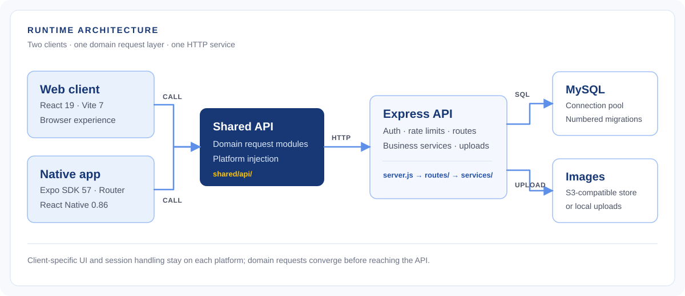

<div align="center">
  

  # XMUMDorm · 厦马小筑

  **A campus life platform built for the Xiamen University Malaysia community.**

  [Live Web App](https://xmumdorm-200-lyzz-production.up.railway.app) · [Architecture](#system-architecture) · [Quick Start](#developer-quick-start) · [Product Journey](#product-journey)

  [](package.json)
  [](app/tsconfig.json)
  [](frontend/package.json)
  [](app/package.json)
  [](app/package.json)
  [](package.json)
  [](database.js)
  [](frontend/package.json)

  [English](README.md) · [简体中文](README_CN.md)
</div>

---

## One campus, one place to belong

XMUMDorm brings campus information, student conversations, and everyday services into one experience. Students can follow official notices, find clubs and events, talk in Tree Hole, explore the canteen, exchange second-hand items, request errands, and organize their schedules. The [Web app](https://xmumdorm-200-lyzz-production.up.railway.app) is available now; the native app is being rebuilt in `app/`.

| Discover | Connect | Get things done |
| :--- | :--- | :--- |
| Campus notices, trends, guides, clubs and activities | Tree Hole posts, comments, likes, saves and reports | Canteen reviews, marketplace, errands, timetable, to-dos and diary |

## System Architecture

**One backend serves two clients; a shared API layer keeps their domain requests aligned.**

<div align="center">
  <a href="docs/assets/system-architecture.svg"></a>
</div>

The Web client uses Vite's development proxy for `/api`; the Expo client injects its API base URL and token provider at startup. The Express service owns authentication, domain routes, business services and upload handling. MySQL is the system of record; image uploads can use an S3-compatible object store, with local upload storage for development. See [`server.js`](server.js), [`shared/api/`](shared/api), [`app/src/shared/api.ts`](app/src/shared/api.ts) and [`services/objectStorage.js`](services/objectStorage.js).

## Engineering Highlights

| Decision | Why it matters | Evidence |
| :--- | :--- | :--- |
| **Share domain API modules across Web and App** | Request paths and response handling have one home, while each platform supplies its own base URL and auth token. | [`shared/api/`](shared/api), [`app/src/shared/api.ts`](app/src/shared/api.ts), [`frontend/vite.config.js`](frontend/vite.config.js) |
| **Treat the native app as a new product surface** | The current Expo Router app has its own navigation, native session storage and mobile interaction model after retiring the old Android client. | [`app/src/app/`](app/src/app), [`app/src/features/auth/tokenStore.ts`](app/src/features/auth/tokenStore.ts), [rebuild commit](https://github.com/yejianqin61-cell/XMUMDorm-2.0.0-LYZZ/commit/b3c2d6c4) |
| **Make visual consistency executable** | A single token source generates platform artifacts; CI checks contrast, brand ramps, token drift and design debt. | [`tokens/design-tokens.css`](tokens/design-tokens.css), [`scripts/gen-tokens.js`](scripts/gen-tokens.js), [quality workflow](.github/workflows/app-rulers-and-tests.yml) |
| **Put boundaries at the API edge** | Request-size limits, production rate limits, authentication middleware and a shared database pool are applied centrally. | [`server.js`](server.js), [`middleware/auth.js`](middleware/auth.js), [`database.js`](database.js) |
| **Keep schema changes and regressions reviewable** | Numbered SQL migrations and separate CI gates cover backend routes, shared modules, Web build and App type checks/tests. | [`migrations/`](migrations), [`scripts/run-incremental-migrations.js`](scripts/run-incremental-migrations.js), [quality workflow](.github/workflows/app-rulers-and-tests.yml) |

## Repository Map

```text
XMUMDorm/
├── app/                 # Expo / React Native app (current rebuild)
│   └── src/
│       ├── app/         # Expo Router screens and layouts
│       ├── features/    # Mobile product features
│       └── shared/      # Native API and query setup
├── frontend/            # React + Vite Web client
│   └── src/             # Routes, pages, features, UI and styles
├── shared/              # Cross-client API, constants and utilities
├── routes/              # Express domain endpoints
├── services/            # Backend business and storage services
├── middleware/          # Authentication, upload and request guards
├── migrations/          # Numbered MySQL schema changes
├── tokens/              # Design token source
├── scripts/             # Migration, verification and asset tooling
├── __tests__/           # Backend, shared and Web tests
├── docs/                # Architecture, product and team documentation
├── database.js          # MySQL connection pool
└── server.js            # HTTP entry point
```

## Developer Quick Start

**Prerequisites:** Node.js 22 (the version used in CI), npm, and MySQL 5.7+ (8.0 recommended). Use a local development database; `DATABASE_URL` and `MYSQL_URL` take precedence over `DB_*` settings.

```bash
git clone https://github.com/yejianqin61-cell/XMUMDorm-2.0.0-LYZZ.git
cd XMUMDorm-2.0.0-LYZZ
npm ci
cd frontend && npm ci && cd ..
cp .env.example .env
# Edit .env: set DB_HOST, DB_USER, DB_PASSWORD, DB_NAME and JWT_SECRET.
npm run migrate:all
node scripts/run-incremental-migrations.js
npm run dev
```

In a second terminal, run `npm run dev:web` and open **http://localhost:5173**. The API health check is **http://localhost:4040/health**. The Web dev server proxies `/api` and `/uploads` to port 4040. Registration requires a configured email provider; see the [local setup guide](docs/team/本地开发环境手册.md) for environment options and troubleshooting.

To work on the native client, run `cd app && npm ci && npm start`. Set `EXPO_PUBLIC_API_BASE_URL` to a backend URL reachable from your device. Native modules may require a development build rather than Expo Go; see the [App preview guide](docs/09-Deploy/release/App本地预览与生产数据连接.md). Before submitting changes, run the relevant checks: `npm test` at the root, `npm run lint && npm run build` in `frontend/`, or `npm run verify` in `app/`.

## Product Journey

From the first authentication commit to the current Web platform and native rebuild, the repository records **January–November 2026** of development. These are selected milestones from Git history, not release claims.

| When | Milestone | Commit |
| :--- | :--- | :--- |
| **Jan 2026** | Project initialized with authentication; the first post system followed days later. | [`fe1c8094`](https://github.com/yejianqin61-cell/XMUMDorm-2.0.0-LYZZ/commit/fe1c8094) · [`9cb77f84`](https://github.com/yejianqin61-cell/XMUMDorm-2.0.0-LYZZ/commit/9cb77f84) |
| **Feb–Mar 2026** | Canteen backend and rankings took shape; the React Web experience gained routing and production preparation. | [`fb337977`](https://github.com/yejianqin61-cell/XMUMDorm-2.0.0-LYZZ/commit/fb337977) · [`6d47f415`](https://github.com/yejianqin61-cell/XMUMDorm-2.0.0-LYZZ/commit/6d47f415) |
| **Apr–May 2026** | Marketplace chat, errands and clubs expanded the platform; moderation and the admin console followed. | [`0244fe2f`](https://github.com/yejianqin61-cell/XMUMDorm-2.0.0-LYZZ/commit/0244fe2f) · [`9785339a`](https://github.com/yejianqin61-cell/XMUMDorm-2.0.0-LYZZ/commit/9785339a) · [`d7d1f3a9`](https://github.com/yejianqin61-cell/XMUMDorm-2.0.0-LYZZ/commit/d7d1f3a9) |
| **Jun–Jul 2026** | The campus square and desktop Web shell were rebuilt around reusable layouts and UI primitives. | [`6108be61`](https://github.com/yejianqin61-cell/XMUMDorm-2.0.0-LYZZ/commit/6108be61) · [`af06d9e2`](https://github.com/yejianqin61-cell/XMUMDorm-2.0.0-LYZZ/commit/af06d9e2) |
| **Aug–Sep 2026** | Shared canteen editing and bilingual Web flows grew; the team then retired App v1 and committed to a clean native rebuild. | [`f9d46bad`](https://github.com/yejianqin61-cell/XMUMDorm-2.0.0-LYZZ/commit/f9d46bad) · [`9d20e3ee`](https://github.com/yejianqin61-cell/XMUMDorm-2.0.0-LYZZ/commit/9d20e3ee) · [`b3c2d6c4`](https://github.com/yejianqin61-cell/XMUMDorm-2.0.0-LYZZ/commit/b3c2d6c4) |
| **Oct–Nov 2026** | Expo SDK 57 established the new App foundation and shared API integration; mobile work, a Web calendar and scope cleanup continued into November. | [`674a7b84`](https://github.com/yejianqin61-cell/XMUMDorm-2.0.0-LYZZ/commit/674a7b84) · [`00db3eb6`](https://github.com/yejianqin61-cell/XMUMDorm-2.0.0-LYZZ/commit/00db3eb6) · [`dfe9fb63`](https://github.com/yejianqin61-cell/XMUMDorm-2.0.0-LYZZ/commit/dfe9fb63) · [`3116546b`](https://github.com/yejianqin61-cell/XMUMDorm-2.0.0-LYZZ/commit/3116546b) |

## Contributors Wall

<div align="center">
  <a href="https://github.com/yejianqin61-cell/XMUMDorm-2.0.0-LYZZ/graphs/contributors">
    
  </a>
  <p>Every contribution is part of the journey. <a href="https://github.com/yejianqin61-cell/XMUMDorm-2.0.0-LYZZ/graphs/contributors">Explore the contributor graph →</a></p>
</div>

## Star Trend

<div align="center">
  <a href="https://star-history.com/#yejianqin61-cell/XMUMDorm-2.0.0-LYZZ&Date">
    
  </a>
</div>

<div align="center">
  <sub>Built by students, for the XMUM community. Questions or feedback? Find the official WeChat account <strong>xmumdorm666</strong> in the app.</sub>
</div>
