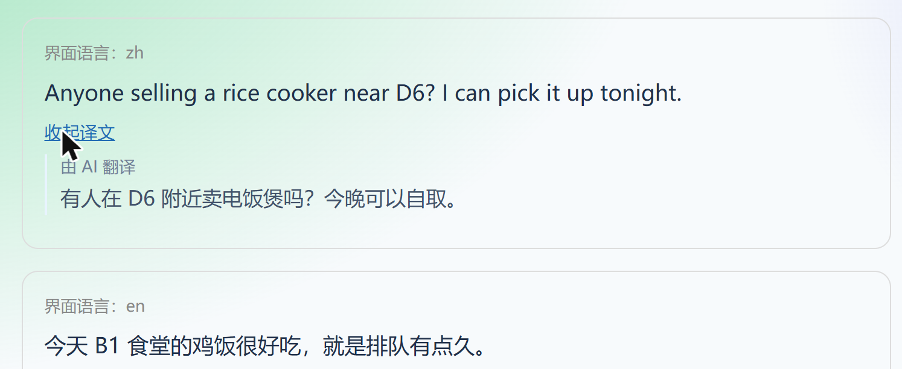

# Web 帖子 / 评论 / 点评 AI 翻译实现记录

日期：2026-11-16　分支：`dev-wx`　需求：[帖子评论点评AI翻译需求](../../01-Requirement/AI翻译/帖子评论点评AI翻译需求.md)

## 做了什么

| 文件 | 改动 |
| --- | --- |
| `services/translation.js` | 新增：OpenAI 兼容 `chat/completions` 翻译器；三个环境变量缺一即 `enabled=false`；内存缓存 500 条（按目标语言 + 原文 SHA-1，最近最少使用淘汰）；20 秒超时 |
| `routes/translate.js` | 新增：`GET /api/translate/config`（免登录，返回是否开启）；`POST /api/translate`（需登录，每用户每分钟 30 次）。只按 `kind`（`post` / `comment` / `review`）+ `id` 从库里取原文，固定三条参数化查询，过滤已删除 / 被隐藏内容 |
| `server.js` | 挂载 `/api/translate` |
| `.env.example` | 新增 `TRANSLATE_API_BASE_URL` / `TRANSLATE_API_KEY` / `TRANSLATE_MODEL` 说明 |
| `shared/utils/translation.js` | 新增：`needsTranslation(text, uiLang)` 按钮显示判定、`translationTarget(uiLang)` |
| `shared/api/translate.js` | 新增：`getTranslateConfig`、`translateContent` |
| `shared/query/queryKeys.js` | 新增 `translateConfig`、`translation(kind, id, target)` |
| `frontend/src/components/TranslateToggle.jsx` / `.css` | 新增：推特式「翻译」按钮 + 译文区，点了才请求，颜色全部取 `tokens.css` |
| `frontend/src/components/PostDetailShell.jsx` | 新增可选 prop `translateKinds`；传了才在正文、评论、回复下挂翻译按钮（另两个复用此壳的页面不受影响） |
| `frontend/src/pages/PostDetail.jsx` | 传 `translateKinds={ post, comment }` |
| `frontend/src/pages/FoodDetail.jsx` | 点评与点评回复下挂翻译按钮（`kind="review"`） |
| `__tests__/routes/translate.test.js` | 新增 8 个用例 |
| `__tests__/shared/translation.test.js` | 新增 5 个用例 |

没有数据库迁移；新增 3 个可选环境变量，不配置时功能整体关闭、其它功能不受影响。

## 证据

1. `npx jest __tests__/routes/translate.test.js`：8 passed。覆盖：免登录读配置、未登录 401、按 kind+id 取原文并以正确的 URL / 密钥头 / 模型调用上游、命中缓存不再请求、非法 kind / id / target / 任意文本 / `__proto__` 一律 400、未配置 503、内容不存在 404、超长 413、上游失败 502 且不泄露上游报错、默认数据源走固定的过滤查询。
2. `npx jest __tests__/shared/translation.test.js`：5 passed。
3. 根目录 `npm test` 全量：**Test Suites: 1 skipped, 80 passed；Tests: 10 skipped, 1160 passed，0 失败**。
4. `npx eslint`（改动的 4 个前端文件）无报错；`npx vite build` 通过。
5. 渲染检查：临时测试页（模拟登录与翻译接口，未提交）在 Chrome 中验证：中文界面英文内容出现「翻译」、英文界面中文内容出现「Translate」、中文界面中文内容不出现；点击后显示「由 AI 翻译」与译文，再点收起。这一步发现并修掉了一个问题：`shared/api/request.js` 已拆掉响应外层 `data`，组件原先多取了一层导致按钮不出现。

## 未验证

- **没有接真实的翻译服务商跑过**：上游调用只在单元测试里用假 `fetch` 验证了请求格式。智谱 / 火山方舟的地址与模型名写在 `.env.example` 里作为示例，开通后需实测一次。
- 没有连真实数据库与真实登录跑完整页面；`PostDetail` / `FoodDetail` 只验证了编译与组件本身的渲染。
- 服务端缓存是进程内存，重启即清空，多实例部署时各自缓存。

## 风险

- 【算得】语言判定是字符比例启发式，日文（含汉字）会被当成中文；混排短句可能判断偏差，只影响按钮是否出现，不影响内容。
- 【提案】限流 30 次 / 分钟 / 人与 4000 字上限是先拍的数，可按实际用量调。
