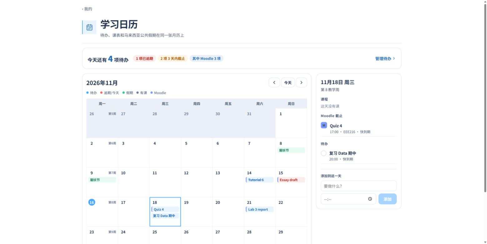

# Moodle 浏览器扩展：实现记录（P0）

日期：2026-11-16　分支：`dev-wx-moodle`　需求：[Moodle 浏览器扩展需求](../../01-Requirement/Moodle浏览器扩展/Moodle浏览器扩展需求.md)（xzy，V0.1 Draft）　任务表：#6「web:moodle接入」　讨论：issue #133

需求 §八 的 Q1–Q5 还没有裁决。这一版**按提出人建议的选项**实现，方便团队直接看效果再决定：
- Q1 立项
- Q2 放在顶层 `extension/`
- Q3 先内测手动加载
- Q4 公告不做
- Q5 先写 `www.xmumdorm.com`、`xmumdorm.com`、`localhost:5173`

团队如果裁决不同，改动面都很小。

截图来自临时测试页（模拟待办接口和扩展回复），该测试页没有提交。

## 做了什么

| 文件 | 改动 |
| --- | --- |
| `shared/moodle/moodle-core.js` | 核心（UMD，扩展和测试共用）：解析课程、课程状态、截止事件；URL 白名单；DDL 判定（和 App 的 `deadlines.ts` 同口径）；投影；读登录态和用户 id（选择器同 App 的 `identity.ts`）；读 `sesskey`；AJAX 错误分类；清洗投影 |
| `extension/manifest.json` | MV3；`permissions` 只有 `storage`，`host_permissions` 只有 `https://l.xmu.edu.my/*` |
| `extension/moodle-sync.js` | Moodle 页面内容脚本：确认登录 → 第 1 批（课程 + 事件第一页）→ 第 2 批（只取有截止事件的课程状态，并取下一页事件）→ 最多 3 批 → 算 DDL → 存 `chrome.storage.local`。10 分钟内不重复自动同步；会话过期时标记 `expired`，旧数据保留 |
| `extension/dorm-bridge.js` | 厦马小筑页面内容脚本：只回应本窗口、命名空间和版本都对的请求，回复只发给本页面 origin |
| `extension/popup.*` | 显示同步状态和时间，提供「立即同步」和「清除 Moodle 数据」 |
| `extension/lib/moodle-core.js` | 核心的副本（扩展免构建）；`npm run extension:sync-core` 生成 |
| `scripts/sync-extension-core.js`、`package.json` | 上面这个复制脚本 |
| `shared/utils/moodleBridge.js` | Web 侧协议：发请求，校验回复（source、origin、ns、版本、请求 id），清洗条目；按吉隆坡时区落到日期；状态和统计 |
| `frontend/src/hooks/useMoodleDeadlines.js` | 用 TanStack Query 包一层；没装扩展时约 0.8 秒后返回 `installed: false` |
| `frontend/src/pages/StudyCalendar.jsx` / `.css` | 月历新增 Moodle 芯片和图例；「今天还有 N 项」把未完成的 Moodle 截止算进去，并标出「其中 Moodle N 项」；当天面板新增「Moodle 截止」，可以点开 Moodle；同步失败时提示并显示上次同步时间；电脑上没装扩展时提示安装（手机不提示） |
| `shared/utils/studyCalendar.js` | 只改了头部注释 |

## 和 App 的关系

- App 的 Moodle 模块**没有改**。`moodle-core.js` 里的 DDL 判定、URL 白名单、身份选择器都照着 App 写，测试用的是校方实站数据的形状（state 的 id 是字符串、整个 state 是 JSON 字符串）。
- 需求说「抽到 shared/，两端同一份」。App 侧改为引用 `shared/moodle/` 要动 TS 类型和注入源码（Hermes 限制），风险大，留作后续 PR。

## 证据

1. `npx jest __tests__/shared/moodleCore.test.js __tests__/shared/moodleBridge.test.js`：36 个通过，覆盖：
   - 解析：隐藏课程跳过；state 的字符串 id；外域链接丢弃；URL 只留白名单参数
   - DDL 判定：assign 的 due、quiz 的 close 算，论坛和 quiz 的 open 不算，链接不对不算，已交标记 done，超过 30 天的过去截止不交给 Web
   - 页面信息：登录态、用户 id、`sesskey`、错误码分类
   - 打包：扩展副本与 shared 一致；manifest 权限最小、没有 cookies；桥接常量一致
   - **同步脚本在模拟环境里跑**：2 个批次、第 2 批只请求有截止的课程；存储里没有 `sesskey`；会话过期标记 `expired`；没登录不发请求
   - Web 协议：6 种伪造回复被拒；脏数据被清洗；超时返回 `installed=false` 并移除监听；23:59 截止不会因为 UTC 落到前一天；统计不含已完成
2. 根目录 `npm test` 全量：80 个套件通过、1 个跳过（原本就跳过）；1177 个用例通过，0 失败。`check:routes-cjs`、`check:server-load` 也通过。
3. `npx eslint` 改动的前端文件：0 问题；`npx vite build` 通过。
4. 临时测试页（模拟扩展回复）在 Chrome 里看过三种状态：有数据、没装扩展（显示安装提示）、登录过期（显示提示和上次同步时间）。

## 真实账号核对（2026-11-16，wx 本人账号、本人浏览器）

wx 在自己的 Chrome 里登录 Moodle 后，在 Moodle 页面里执行了扩展的同一套请求和 `moodle-core.js` 的同一套判定（只看结果，数据没有离开这台电脑，也没有进仓库）：

- 页面里能读到用户 id 和 `sesskey`；第 1 批（课程 + 截止事件）、第 2 批（2 门课的课程状态）都返回 200，没有错误码。**同源 `fetch` 带登录态可行**，不需要改成 MAIN world。
- 解析结果：6 门在读课程，4 条截止事件（都是 assign 的 due），2 门课的状态共 35 个活动。
- 判定结果：4 条全部按「课程 + 活动链接」配对成功，进入日历。其中 1 条 `actionable=false`（Moodle 认为不用再操作，按已完成显示），其余 3 条未完成。截止时间按吉隆坡时区换算后和 Moodle 页面一致。
- 发现并修正了一个问题：校方课程的 shortname 写法很乱（如 `EEE211*_2`、`EMath`、`EEE2032609Lian`）。改成从全名里取课程代码（`EEE211`、`COM205`、`EEE202`…），取不到时用截断的全名（`courseLabel`，新增 6 个用例）。

## 仍未验证

- 扩展本身（`chrome://extensions` 加载已解压的扩展，以及弹窗页面）没有在浏览器里装过。上面的核对是在页面里直接执行同样的代码，内容脚本在隔离环境里运行时，同源 `fetch` 的行为按 Chrome MV3 文档是一样的。
- 生产域名（Q5）没有确认。

## 风险

- 【算得】依赖校方 Moodle 的页面结构（登录态、`data-userid`、内联 `M.cfg`）和 AJAX 接口。学校升级 Moodle 后，弹窗会显示「同步失败」，不会显示错误数据。
- 【算得】截止事件超过 100 条时只同步前 100 条，弹窗会提示。
