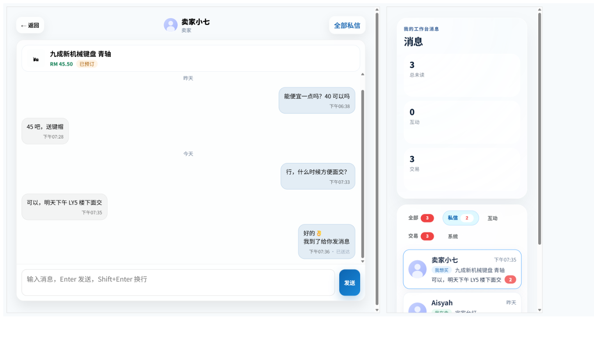

# 二手市场私信体验与信箱联动：实现记录

日期：2026-11-16　分支：`dev-wx-market`　需求：[二手私信与信箱联动需求](../../01-Requirement/二手市场/二手私信与信箱联动需求.md)

左边是聊天页（对方、商品卡片、日期分隔、已送达），右边是手机宽度下信箱的「私信」Tab。截图来自临时测试页（模拟登录和接口），该测试页没有提交。

## 做了什么

| 文件 | 改动 |
| --- | --- |
| `routes/marketplace.js` | `GET /chat/threads/:id/messages`：线程查询顺带连 `users` 和首张商品图，`thread` 追加 `role`、`peer`、`peer_last_read_at`、`item{id,title,price,status,cover,available}`，没有多发查询。`POST /chat/threads/:id/read`：更新已读边界后，把当前用户这条对话的 `marketplace_chat` 通知标已读（`JSON_EXTRACT(extra,'$.targetId') = 对话 ID`），失败只记日志；返回值多一个 `notifications_read` |
| `shared/utils/marketplaceChat.js` | 新增纯函数：合并分页并去重、下一页游标、日期分隔、是否已读、未读求和、商品状态文案 |
| `frontend/src/pages/Marketplace/MarketplaceChat.jsx` | 聊天页重写：对方信息、商品卡片、日期分隔、查看更早消息（保持滚动位置）、已读或已送达、发送中和失败重发、Enter 发送、字数倒计。收到对方新消息时再次标已读，并让信箱的会话列表缓存失效 |
| `frontend/src/pages/Marketplace/Marketplace.css` | 新增聊天页样式，颜色、间距、圆角全部用 `tokens.css` 变量 |
| `frontend/src/components/MailboxChats.jsx` / `.css` | 新增信箱「私信」列表（空状态、错误重试、加载更多） |
| `frontend/src/pages/Mailbox.jsx` | 新增「私信」Tab：`useInfiniteQuery` 拉 `listMyChatThreads`，Tab 角标和列表共用一份数据；支持 `?tab=chats`；切到私信 Tab 时不请求通知列表，隐藏「清空」 |
| `__tests__/routes/marketplaceChatLifecycle.test.js` | 已读接口多了一次通知更新查询，补 mock，断言下标顺延 |
| `__tests__/routes/marketplaceChatMailboxSync.test.js` | 新增 7 个用例 |
| `__tests__/shared/marketplaceChat.test.js` | 新增 9 个用例 |

## 证据

1. `npx jest __tests__/routes/marketplaceChat __tests__/shared/marketplaceChat.test.js`：5 个套件、39 个用例全部通过。
   - 已读联动：买家和卖家各按自己的 `user_id` 更新通知；通知更新报错时接口仍返回 200；无关用户 403，并且只查了 1 次库，没碰通知表。
   - 会话详情：买家和卖家视角下 `peer` 与 `peer_last_read_at` 取对方；价格转成数字；商品删除后 `available=false`；原有字段仍在。
2. 根目录 `npm test` 全量：80 个套件通过、1 个跳过（原本就跳过）；1163 个用例通过，0 失败。
3. `npx eslint` 改动的前端文件：0 问题；`npx vite build` 通过。
4. 临时测试页里用 Chrome 实际操作过：
   - 信箱「私信」Tab 显示 3 条对话，第一条带 2 条未读，删除的商品显示「（商品已删除）」
   - 进入对话：显示「卖家小七 · 卖家」和「RM 45.50 · 已预订」，有「昨天」「今天」分隔，最后一条显示「已送达」
   - 点「查看更早的消息」出现「11月14日」两条，画面没有跳
   - 模拟第一次发送失败：消息显示「发送失败 · 重发 · 删除」；点「重发」后第二次请求成功，失败标记消失
   - 宽度 375 下排版正常

## 未验证

- 没有连真实 MySQL 跑。`JSON_EXTRACT(extra, '$.targetId') = ?` 在 MySQL 5.7+/8.0 下对数字比较成立，写入端是 `JSON.stringify` 的数字 `targetId`，但没在线上库实测。
- 没有用真实账号两端对聊。

## 风险

- 【算得】通知更新带 `user_id` 和 `type` 条件，走 `notifications` 现有的 `user_id` 索引，单个用户的私信通知量很小。
- 【提案】未读数现在有两份口径：信箱「交易」按通知条数算，「私信」按对话里对方发来、我还没读的消息算。读完对话后两边会一起归零。
