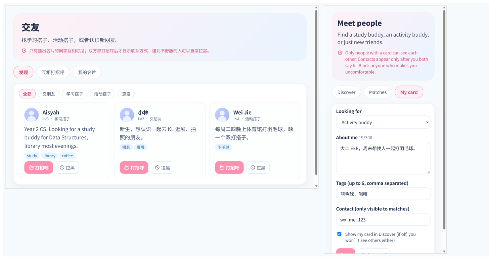

# 交友模块：实现记录

日期：2026-11-16　分支：`dev-wx-date`　需求：[交友模块需求](../../01-Requirement/交友/交友模块需求.md)

左边是桌面端的「发现」，右边是手机宽度、英文的「我的名片」。截图来自临时测试页（模拟登录和接口），该测试页没有提交。

## 做了什么

| 文件 | 改动 |
| --- | --- |
| `migrations/082_date_profiles.sql` | 新建 `date_profiles`、`date_likes`、`date_blocks`，不改已有表。执行：`node scripts/apply-sql-file.js migrations/082_date_profiles.sql` |
| `routes/date.js` | 8 个接口（见文件头注释），全部需要登录。采用工厂函数 `createDateRouter`，方便测试。写名片前依次过条款确认、禁言检查和敏感词过滤（标签会拼进 `summary` 一起检查）；打招呼按用户限流，每小时 60 次 |
| `server.js` | 挂载 `/api/date` |
| `services/notificationService.js` | 新增 `date_match`，模块是 `date`，归入「互动」 |
| `shared/api/date.js` | 前端接口；用 `isNeedProfileError` 识别"先写名片"这种 403 |
| `frontend/src/pages/DatePage.jsx` / `.css` | 页面，三个 Tab（发现、互相打招呼、我的名片），样式全部用 tokens |
| `frontend/src/routes/layoutRoutes.jsx`、`siteShellNav.js` | 路由 `/about/date`（懒加载），导航「交友」 |
| `frontend/src/pages/Mailbox.jsx` | `date_match` 通知的文案：「你和 X 在交友里互相打了招呼…」 |
| `__tests__/routes/date.test.js` | 新增 23 个用例 |
| `__tests__/frontend/datePage.test.js` | 新增 3 个用例 |

## 证据

1. 新增测试全部通过。接口部分覆盖：
   - 输入校验 9 条
   - upsert 写名片；命中敏感词时不写库
   - 没名片或名片隐藏时返回 403；列表 SQL 里没有 `contact`，并排除自己、已打招呼、双向拉黑、非学生、被封禁
   - 单方面打招呼不通知；互相打招呼双方各一条通知且指向对方；重复点不重复通知
   - 被拉黑时返回 404，不写招呼
   - 互相打招呼列表带联系方式；拉黑会清掉双方的招呼；删除名片会连同我发出的招呼一起删
2. 根目录 `npm test` 全量：80 个套件通过、1 个跳过（原本就跳过）；1173 个用例通过，0 失败。
3. `npx eslint` 改动的前端文件：0 问题；`npx vite build` 通过。
4. 临时测试页里用 Chrome 走过完整流程：没有名片时提示 → 写名片并保存 → 发现页出现 3 张名片 → 向对方已打过招呼的人打招呼，进入「互相打招呼」后看到联系方式 → 拉黑一人后该名片消失。另外看过手机宽度和英文。

## 未验证

- 没有连真实 MySQL 跑迁移和查询；没有用两个真实账号对测。
- 被禁言用户写名片会被 `checkSanction` 拦截，这一点沿用全站中间件，没有为本模块单独测。

## 风险

- 【提案】交友类功能有骚扰和隐私风险。本期用了这些办法降低风险：互相可见、联系方式延后、拉黑、不收集性别和照片、敏感词过滤。上线前建议团队定一下审核和举报的流程。
- 【算得】`date_likes` 和 `date_blocks` 都有反向索引，发现页的排除条件走 `NOT EXISTS` 加主键或索引；名片表有 `(visible, looking_for, updated_at, user_id)` 联合索引。
