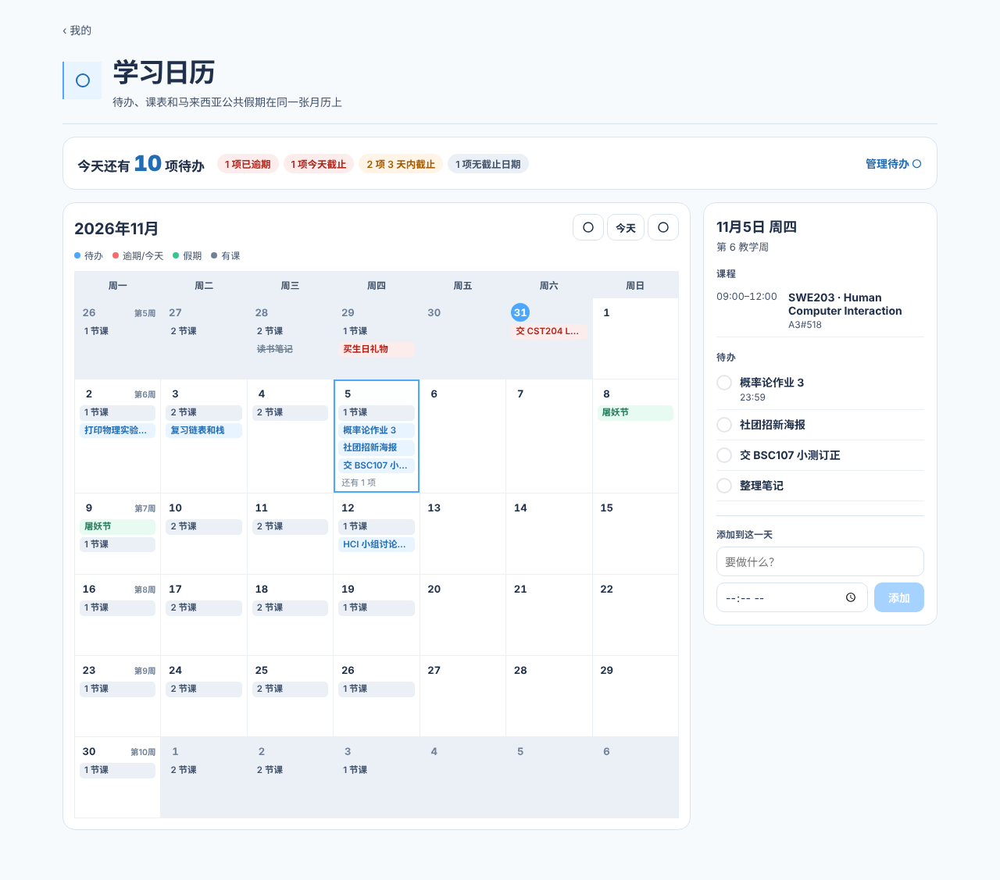
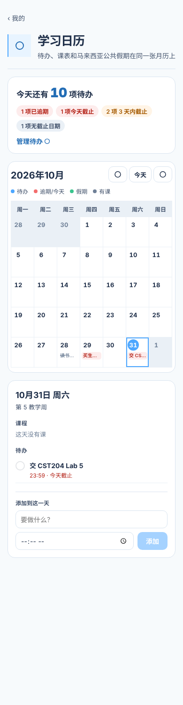

# 学习日历与今日待办实现记录

日期：2026-10-31　分支：`dev-xzy`　任务卡：[Task-学习日历-合并月历与今日待办](../05-Tasks/学习日历/Task-学习日历-合并月历与今日待办.md)

## 做了什么

| 文件 | 改动 |
| --- | --- |
| `shared/utils/studyCalendar.js` | 新增纯函数：`monthGrid`（周一开头、行数按需）、`teachingWeekOf` / `teachingWeeksIn`（教学周）、`holidaysOn`、`classesOn`（按周次 + 星期取课）、`todoState` / `summarizeTodos`（今日待办统计）、`groupTodosByDate`、`shiftMonth`、`localYmd`、`isoWeekday` |
| `frontend/src/hooks/useAllTodos.js` | 新增：分页拉取全部待办（接口单页上限 50，最多 10 页）；query key 在 `['todos', …]` 下，待办增删改后自动刷新 |
| `frontend/src/pages/StudyCalendar.jsx` / `.css` | 新页面 `/myzone/calendar`：今日待办统计条、月历（待办 / 假期 / 「N 节课」/ 每周一标「第 N 周」）、当天详情（课程、待办勾选、给这一天添加待办） |
| `frontend/src/routes/layoutRoutes.jsx` | 新增懒加载路由 `myzone/calendar` |
| `frontend/src/pages/MyZone.jsx` | 「工具」区新增「学习日历」入口 |
| `frontend/src/pages/TodoList.jsx` / `.css` | 标题下新增「今天还有 N 项待办」统计条（逾期、今天截止）与「日历视图」入口；统计按全部待办计算，不受筛选影响 |
| `__tests__/shared/studyCalendar.test.js` | 新增 18 个用例 |

没有新接口、没有数据库迁移、没有环境变量变化；全部复用 `GET/POST/PATCH /api/todos` 与 `GET /api/schedule/week`。

## 数据流

- 待办：`useAllTodos` → `groupTodosByDate`（月历）+ `summarizeTodos`（统计）。
- 课表：月历可见范围内的教学周（最多 6 周）各请求一次 `/api/schedule/week?week=N`，`useQueries` 缓存 5 分钟；`classesOn` 按「该日所属周次 + 星期几」取 `days[weekday]`。
- 假期：`shared/config/holidays.js` 的 `ALL_HOLIDAYS`。
- 不含 Moodle：Web 端拿不到 Moodle 数据（只在 App 内经 WebView 同步），任务卡已注明。

## 证据

本次会话的执行环境无法访问 npm 仓库（`registry.npmjs.org` 被出口代理拒绝），**装不上项目依赖**，因此用了以下替代验证：

1. **单元测试**：用一个极简 Jest 替身（仅实现 `describe / it / expect` 常用断言）直接以 Node 运行：
   - `__tests__/shared/studyCalendar.test.js`：**18 passed, 0 failed**
   - 对照：在未改动的 `main` 工作树与本分支上分别跑 `__tests__/{frontend,shared,shared/utils,web,utils}` 下共 38 个测试文件，**两边结果逐文件完全一致**（无回归），本分支多出上面的 18 个用例。其中 `chunkLoadRecovery`（含「每个懒加载路由都被 RouteErrorBoundary 包住」）20/20 通过。
2. **编译检查**：用 esbuild 打包 `StudyCalendar.jsx`、`TodoList.jsx`、`MyZone.jsx`、`layoutRoutes.jsx`（含整棵路由树），全部通过。
3. **渲染检查**：用 esbuild + 测试替身（模拟登录、待办与课表接口、路由和图标）在 Chromium 中渲染页面，桌面 1280px 与手机 390px 均正常；在详情面板添加待办后统计与月历即时刷新。截图（图标为测试替身的占位圆圈，非真实图标）：
   - 
   - 

## 未验证

- 根目录 `npm test` 全量（应为 46 套件 / 668 用例 + 本次 1 套件 18 用例）**未运行**。
- `frontend` 的 `npm run lint`、`npm run build` **未运行**；`frontendSourceLint` 的 no-undef 全量扫描需要 frontend 依赖，同样未运行。
- 未连接真实后端与数据库；未用真实账号检查课表、待办数据。
- 未做非实现者人工复核。

合并前请在本地执行：`npm test`、`cd frontend && npm run lint && npm run build`，并用真实账号打开 `/myzone/calendar` 与 `/myzone/todos` 检查。

## 风险

- 【算得】待办超过 500 条时，日历只取前 500 条（按截止时间排序）。
- 【已定】「今天 / 逾期」按浏览器本地日期，与待办页一致；课表周次按吉隆坡时区的学期日历。两者在跨时区使用时可能相差一天，与现有页面行为相同。
- 【提案】`tokens.css` 没有「危险色文字」令牌（`--color-danger` 作文字对比度不足），本页局部定义 `--study-calendar-danger-text: #b42318`；是否提升为全局令牌请 Web 前端治理负责人决定。
