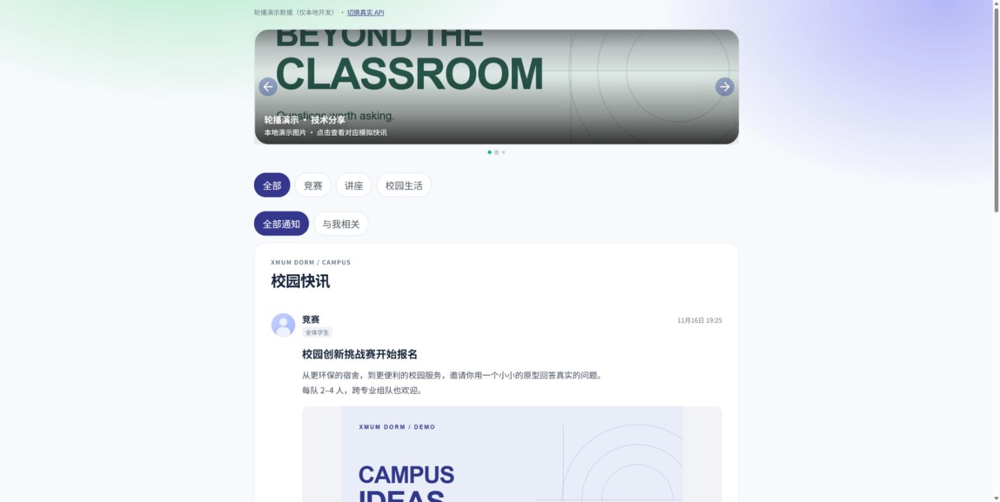
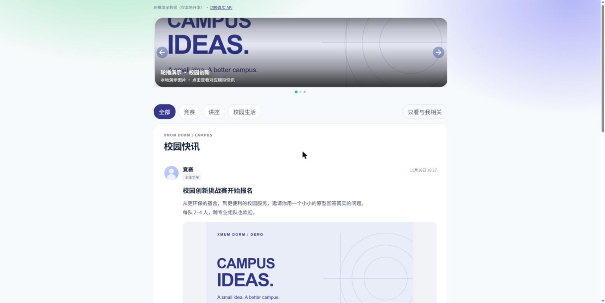

# 广场页面 UI 优化：实现记录

日期：2026-11-16　分支：`dev-wx-square`　需求：[广场页面UI优化需求](../../01-Requirement/广场/广场页面UI优化需求.md)

| 改前 | 改后 |
| --- | --- |
|  |  |

截图来自临时测试页（模拟登录和快讯接口），该测试页没有提交。

## 做了什么

| 文件 | 改动 |
| --- | --- |
| `frontend/src/features/campus-news/CampusNewsRemote.jsx` | 筛选合成一行（分类加上「只看与我相关」开关）；全部文案按界面语言切换；`placeholderData` 保留上一屏，更新中半透明且不能重复点；只有一页时隐藏翻页，显示「第 N / M 页」；翻页后 `scrollIntoView` 回到列表顶部。`NewsFailure` 也补了英文（快讯详情页共用） |
| `frontend/src/features/campus-news/CampusNewsFeed.jsx` | 列表为空时不再显示「暂时没有更多快讯」 |
| `frontend/src/features/campus-news/CampusNewsCard.jsx` | 真实快讯的点赞和评论按钮补英文读屏文字和提示；点赞失败的提示加上 class |
| `frontend/src/features/campus-news/CampusNews.css` | 新增工具栏、开关、翻页、更新中、错误提示的样式（沿用本文件已有的配色写法） |
| `__tests__/frontend/squareCampusNewsUi.test.js` | 新增 4 个源码守卫用例 |

## 证据

1. 新增测试 4 个通过；根目录 `npm test` 全量：79 个套件通过、1 个跳过（原本就跳过）；1151 个用例通过，0 失败。
2. `npx eslint` 改动文件：0 问题；`npx vite build` 通过。
3. 临时测试页里用 Chrome 实际操作过：
   - 筛选只有一行，「只看与我相关」点了之后变成实线和选中色
   - 翻到第 2 页后，页面从 `scrollY=1119` 滚回列表顶部（`scrollY=284`，列表顶端在 283），翻页显示「第 2 / 3 页 · 共 23 条」
   - 英文界面（375 宽）：All / Competitions / Lectures / Campus life / Relevant to me
   - 空列表：只有「暂时没有校园快讯。」，没有翻页

## 未验证

- 没有连真实后端，也没有放在完整站点外壳里看。测试页没有站点背景，所以截图里窄屏的底色和线上不同。
