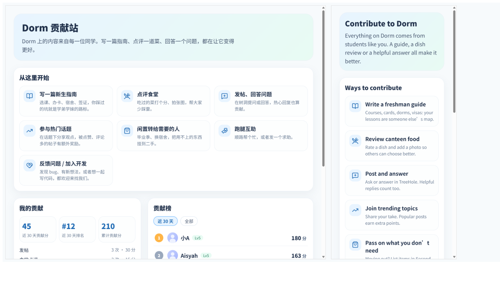

# Dorm 贡献站：实现记录

日期：2026-11-16　分支：`dev-wx-contribute`　需求：[Dorm贡献站需求](../../01-Requirement/贡献站/Dorm贡献站需求.md)

左边是桌面端（已登录），右边是手机宽度、英文、未登录。截图来自临时测试页（模拟登录和接口），该测试页没有提交。

## 做了什么

| 文件 | 改动 |
| --- | --- |
| `routes/contribute.js` | 新增只读接口。`GET /api/contribute/leaderboard?range=30d\|all`：公开，Top 20，缓存 5 分钟，非法 range 返回 400。`GET /api/contribute/me`：需登录，返回 30 天分项、总计和排名。采用工厂函数 `createContributeRouter({query,cache,auth,assetUrl})`，方便测试 |
| `server.js` | 挂载 `/api/contribute` |
| `shared/api/contribute.js`、`shared/query/queryKeys.js` | 前端接口和查询键 |
| `frontend/src/pages/Contribute.jsx` / `.css` | 新页面，样式全部用 `tokens.css` 变量 |
| `frontend/src/routes/layoutRoutes.jsx` | 注册懒加载路由 `/about/contribute` |
| `frontend/src/components/shell/siteShellNav.js` | 左侧导航新增「贡献站」（`Award` 图标），排在「加入我们」前面 |
| `__tests__/routes/contribute.test.js` | 新增 8 个用例 |
| `__tests__/frontend/contributePage.test.js` | 新增 4 个用例：路由、导航顺序、入口都是已注册路由、文案覆盖全部行为 |

## 实现要点

- `database.query` 用的是 `pool.execute`，在 MySQL 8 下 `LIMIT ?` 和 `INTERVAL ? DAY` 绑参数会报错。所以这两个值直接写进 SQL；它们只来自代码里的常量白名单（20、30），不是用户输入。
- 排名的算法：统计 30 天贡献分比我高的学生有几个，再加 1。没有贡献的用户不排名，也不发这条查询。

## 证据

1. `npx jest __tests__/routes/contribute.test.js __tests__/frontend/contributePage.test.js __tests__/frontend/brandAndJoinUs.test.js`：全部通过，原有「加入我们」的导航顺序测试不受影响。
2. 根目录 `npm test` 全量：80 个套件通过、1 个跳过（原本就跳过）；1159 个用例通过，0 失败。
3. `npx eslint` 改动的前端文件：0 问题；`npx vite build` 通过。
4. 临时测试页里用 Chrome 实际操作过：桌面和 375 宽两种排版；切换「近 30 天 / 全部」会重新请求，数据随之更新；未登录时「我的贡献」提示登录。截图时发现入口卡片在没有全局 `box-sizing` 的环境下会互相重叠，已在页面 CSS 里自带 `border-box`。

## 未验证

- 没有连真实 MySQL 跑。SQL 只在单元测试里检查过结构，没在线上数据上测过性能。`exp_logs` 有 `(user_id, created_at)` 索引；榜单查询按行为和时间扫描，但有 5 分钟缓存。

## 风险

- 【提案】"贡献站"的定义来自我对标题的理解，团队如果另有设想，可以在这个页面上加板块，也可以改方向。
- 【算得】`exp_logs` 很大以后，全部时间榜是全表聚合；如果变慢，可以改成从 `users.exp` 里减去登录、点赞部分，或者加一张汇总表。
