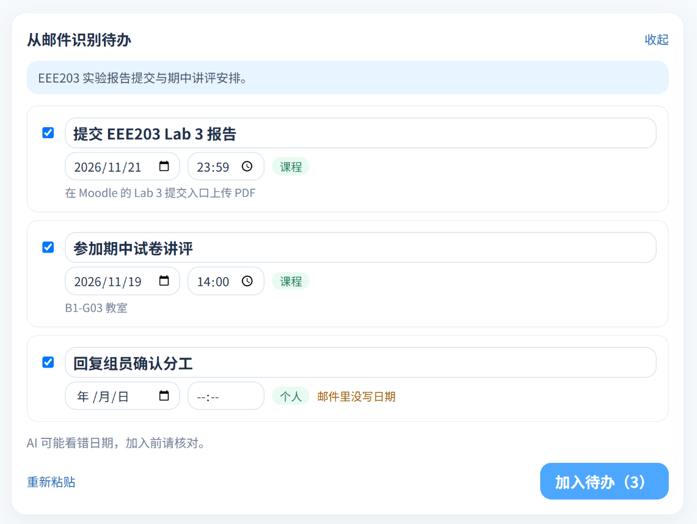

# 邮件识别待办：实现记录

日期：2026-11-16　分支：`dev-wx-mail`　需求：[邮件识别待办需求](../../01-Requirement/邮件识别/邮件识别待办需求.md)

截图来自临时测试页（模拟识别接口），该测试页没有提交。

## 做了什么

| 文件 | 改动 |
| --- | --- |
| `services/mailExtract.js` | `createMailExtractor({baseUrl, apiKey, model, fetchImpl, timeoutMs})`：调用 OpenAI 兼容的 `chat/completions`，`temperature 0`，提示词里带上今天的日期和界面语言；`parseModelOutput` 容忍代码块包裹，逐字段校验；`pickConfig` 优先读 `MAIL_AI_*`，没有就回退到 `TRANSLATE_API_*` |
| `routes/mailReader.js` | `GET /api/mail-reader/config`；`POST /api/mail-reader/extract`（需登录，每分钟 6 次，空内容 400，过长 413，未开启 503，上游出错 502）。日志只记错误码 |
| `server.js` | 挂载 `/api/mail-reader` |
| `.env.example` | 新增注释掉的 `MAIL_AI_*` 示例 |
| `shared/api/mailReader.js` | 前端接口 |
| `frontend/src/components/MailToTodos.jsx` / `.css` | 粘贴、识别、勾选和修改、加入待办；样式用 tokens |
| `frontend/src/pages/TodoList.jsx` | 在「新建待办」按钮上方挂入口（打开新建表单时隐藏） |
| `__tests__/routes/mailReader.test.js` | 新增 12 个用例 |

## 证据

1. `npx jest __tests__/routes/mailReader.test.js`：12 个通过。覆盖：输出清洗（非法日期、优先级夹紧、分类白名单、最多 8 条、非 JSON 报错）；上游请求格式；配置不齐时关闭；配置回退；401、400、413、503；马来西亚日期；502 时日志和响应里都不含邮件原文和内部错误。
2. 根目录 `npm test` 全量：79 个套件通过、1 个跳过（原本就跳过）；1159 个用例通过，0 失败。
3. `npx eslint` 改动的前端文件：0 问题；`npx vite build` 通过。
4. 临时测试页里用 Chrome 实际操作过：粘贴英文课程邮件 → 识别出 3 条 → 取消勾选 1 条 → 加入待办。网络请求里只发了 2 次 `POST /api/todos`，日期、时间、分类、备注都对，面板随后收起。

## 未验证

- 没有接真实 AI 服务商跑过，模型对真实邮件的识别准确率未知。上游请求格式只在单元测试里用假 `fetch` 验证过。
- 待办页的完整渲染没有连真实后端跑过，只单独渲染了入口组件。

## 风险

- 【提案】AI 可能把日期看错，所以识别结果都要用户确认后才写入，界面上也提示了「加入前请核对」。
- 【算得】每次识别最多 8000 字，按 GLM-4-Flash 的免费额度，日常用量足够。
