# App 第四轮治理审计（UI/UX · 交互 · 功能完善）

**日期**：2026-11-21　**性质**：evaluation 层（审计 + 需求发掘）　**环境**：Android 15 AVD `Pixel_API35`（部分项 Android 13 `Pixel_7haha`）· 深色 · 游客态 · 本机后端连生产库 · 代码 `dev-yjq@06b0ce6c`

**总览 issue**：待发布

## 1. 结论

所有者的判断成立：当前 App **不缺功能骨架，缺的是"第一印象"和"手感"**。三类根因：

1. **游客第一屏全是错误**：未登录被当成"无权限"（红锁 + 空插值文案）、新装就提示"会话过期"、详情要登录、登录后不回原处 —— 用户还没看到价值就被拦下（R4-01/02/07）。
2. **没有视觉焦点和反馈**：每个区块"大粗标题 + 横线"、头部不折叠吃掉 40% 屏、蓝黄色无语义、0 处触感、几乎无动效、下拉刷新只有 3 处（R4-10/11/12/17）。
3. **信息架构重复和断裂**：跑腿两个入口、指南正文要跳浏览器、校方系统被挤到折叠线下、二手/指南缺评论举报等社区基本能力（R4-24/25/27/23）。

另有 6 个 P0 缺陷（重复 key 全局报错、返回键压状态栏、跑腿电话对游客公开、深链错位、生产测试数据）。

⚠ **覆盖范围**：本轮没有测试账号，只审计了游客可见页面（约 25 屏）。消息、我的、发布、点评、待办编辑等登录态页面需 R4-33 落地后补审。

## 2. 方法

- 在模拟器上逐页打开一级/二级路由并截图（证据在 `img-round4/`）；读 logcat。
- 源码扫描：下拉刷新、骨架屏、触感、动效、长列表、登录跳转、401/403 映射。
- 对照：《App 设计宪法》v1.4、`docs/app/task/Dormapp第三期治理目标.md`（所有者逐页意见）、上一轮 `校方系统WebView评估与UIUX改进方向.md`。

| 扫描项 | 结果 |
|---|---|
| 触感 haptics | 0 处 |
| reanimated 动效 | 1 个文件 |
| 下拉刷新 `PullToRefresh` | 3 个页面 |
| 骨架屏 | 3 处 |
| ScrollView 页面 / FlashList 使用 | 28 / 4 |
| 登录成功回跳（returnTo） | 无 |

## 3. 需求清单

### P0 · 必须先做（缺陷 / 信任 / 首屏）

| 编号 | 区域 | 需求 | issue |
|---|---|---|---|
| R4-01 | 登录注册 | 未登录用户一打开就提示"会话过期" | — |
| R4-02 | 全局 | 游客到处是红锁「Not allowed / needs a  account / Switch account, then retry」 | — |
| R4-03 | 全局 | 每个页面都弹红色「Encountered two children with the same key」 | — |
| R4-04 | 全局 | 二级页面返回按钮与状态栏重叠，注册页标题压在状态栏上 | — |
| R4-05 | 跑腿 | 跑腿详情对游客公开联系电话；已完成的任务仍显示「Call」 | — |
| R4-06 | 全局 | 深链与 Tab 跳转错位：/canteen 落到广场 Today；「我的」未登录白屏 | — |
| R4-07 | 登录注册 | 登录墙重设计：先让人逛，再在需要时登录，并回到原处 | — |
| R4-17 | 广场 | 广场首页重构：头部占了 40% 屏且不折叠，内容区太小 | — |
| R4-18 | 广场 | 「今日」改成时间轴：下一节课 + Moodle 截止 + 按时出现的签到入口 + 待办 | — |
| R4-27 | 工具 | 工具页重排：校方系统入口被挤到折叠线下 | — |
| R4-33 | 全局 | 治理前置：专用测试账号 + 隔离预览库，让 agent 能自测登录态页面 | — |

### P1 · 本轮主体

| 编号 | 区域 | 需求 | issue |
|---|---|---|---|
| R4-08 | 登录注册 | 注册页重做：品牌、步骤感、校验即时反馈 | — |
| R4-09 | 登录注册 | 首次启动引导：3 屏讲清「课表 / Moodle / 签到」并完成关键授权 | — |
| R4-10 | 全局 | 全局视觉基线重做：层级、间距、卡片、分割线（当前"毫无吸引力"的根因） | — |
| R4-11 | 全局 | 交互反馈缺失：没有触感、几乎没有动效、按下无反应 | — |
| R4-12 | 全局 | 加载 / 刷新 / 空态统一：全站只有 3 处下拉刷新、3 处骨架屏 | — |
| R4-13 | 全局 | 二级 Tab 统一成可横滑的下划线 Tab，去掉圆角胶囊按钮 | — |
| R4-15 | 全局 | 文案与多语言：截断、单复数、中英混排 | — |
| R4-16 | 全局 | 生产环境测试数据清理与内容门槛 | — |
| R4-19 | 广场 | 树洞：标签筛选别用下拉框；卡片层次与互动区 | — |
| R4-21 | 食堂 | 食堂 Tab：排行榜没有区分度、区域入口缺失、「今天吃什么」没有仪式感 | — |
| R4-22 | 食堂 | 菜品详情与点评：游客不能看、无二级回复、评级标签太大 | — |
| R4-23 | 二手 | 二手详情：没有卖家信息、评论、点赞、举报；图片竖着堆 | — |
| R4-24 | 跑腿 | 跑腿：入口重复、卡片信息层次弱、状态流转不清 | — |
| R4-25 | 新生指南 | 新生指南：正文不在 App 里、只有「Open browser」；点赞数显示成「–」 | — |
| R4-28 | 工具 | 课程表：周数横滑、同课同色、去周末、提醒权限时机 | — |
| R4-29 | 工具 | 待办：游客也能看到「Add todo」、优先级 High/Medium/Low/Normal 语义重叠 | — |
| R4-30 | 工具 | 校方系统 WebView 剩余问题：签到每次重登、新窗口丢会话、AC 桌面页、校园网提示 | — |
| R4-31 | 消息 | 消息 / 信箱：按钮主次、点击跳转到对应内容（需登录复核） | — |
| R4-32 | 我的/发布 | 「我的」与发布中心：游客态可用、发布流程体验（需登录复核） | — |

### P2 · 有余力再做

| 编号 | 区域 | 需求 | issue |
|---|---|---|---|
| R4-14 | 全局 | 长列表性能：28 个页面用 ScrollView，FlashList 已装却只用在 4 处 | — |
| R4-20 | 广场 | 万能墙：卡片底色与暗色主题冲突、日期被截断 | — |
| R4-26 | 社团 | 社团列表只有名字和关注数，没有吸引力 | — |

## 4. 逐条详情

### R4-01 · 未登录用户一打开就提示"会话过期"（P0 · —）

**现状**
- 全新安装、从未登录，打开登录页顶部就是黄色「Session expired」。
- 根因：游客浏览时请求到需要鉴权的接口（今日课表等）返回 401，`features/auth/session.tsx` 的 `handleAuthFailure → markExpired` 不分状态一律置 `expired`。

**期望**
- 只有「之前是 `signedIn`、现在收到 401」才算过期；`signedOut` 收到 401 保持 `signedOut`。
- 游客态不去请求必须登录的接口（或请求了也静默）。

**验收**
- 新装 App 首次打开登录页无「会话过期」提示
- 已登录后令牌失效，登录页仍显示过期原因
- 补单测覆盖 signedOut + 401

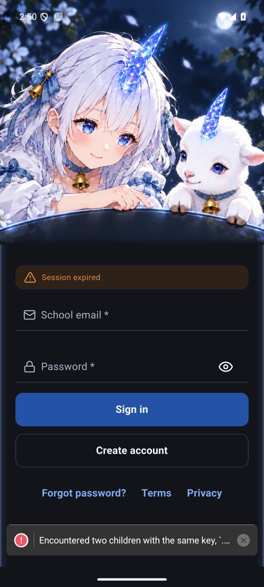

### R4-02 · 游客到处是红锁「Not allowed / needs a  account / Switch account, then retry」（P0 · —）

**现状**
- 广场·Today、工具·今日课表、今日待办、待办页，游客看到的全是红色锁 + 「Not allowed」。
- 文案参数为空（`needs a  account` 中间两个空格），按钮却叫「切换账号」——用户根本没有账号。
- 根因：401（未登录）和 403（无权限）被合并映射成 `permission`（如 `campusModel.ts:87`、`ClubScreens.tsx:42`）。

**期望**
- 新增「未登录」态：灰色插画 + 「登录后同步」+ 主按钮「去登录」，⛔ 红色只留给真正的错误。
- 403 才显示「无权限」，且带具体角色。
- 把 401/403 分类收口到一个 `classifyHttpError`，全 App 一改全改。
- 课表、待办这种本地优先的数据，游客态直接展示本地内容。

**验收**
- 游客浏览所有一级页面不出现红锁
- 全仓不存在空插值的错误文案（加一条 i18n 测试）

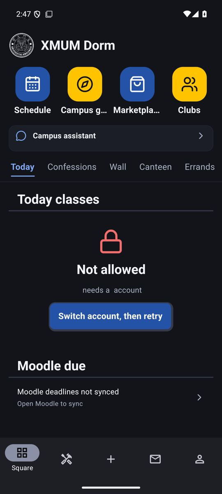 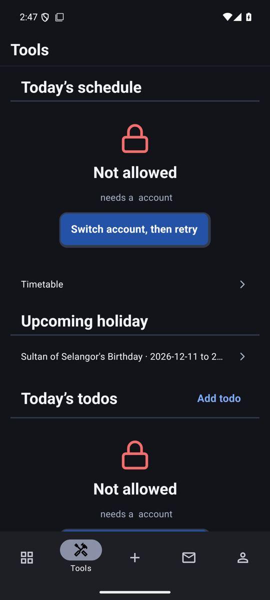 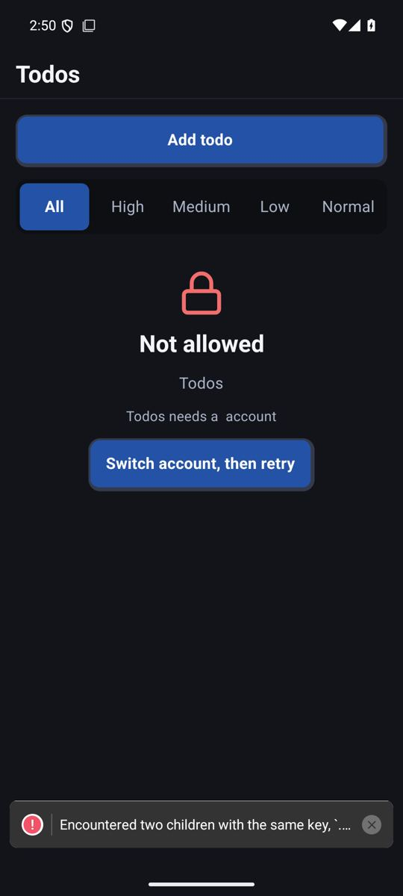

### R4-03 · 每个页面都弹红色「Encountered two children with the same key」（P0 · —）

**现状**
- 开发包里每一页底部都有红色 LogBox：React 列表 key 重复。key 重复会导致列表项错位、丢失或重复渲染（正式包里不报错，但错位照样发生）。
- 另有大量 reanimated「shared value .value inside inline style」警告。

**期望**
- 定位并修复重复 key（按列表逐个查，key 用稳定 id，⛔ 不用 index 拼接）。
- 清掉 reanimated 警告。
- `devicectl smoke` 增加「ReactNativeJS 0 error / 0 warning」门槛。

**验收**
- 冷启动并走一遍五个 Tab，logcat 无 `same key`
- smoke 门槛接入

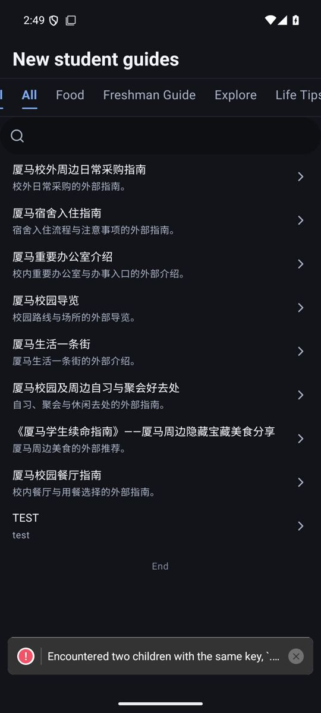

### R4-04 · 二级页面返回按钮与状态栏重叠，注册页标题压在状态栏上（P0 · —）

**现状**
- 二手详情、跑腿详情、指南详情：左上角返回箭头和系统时间叠在一起（安全区顶部没让开）。
- 注册页「Sign up」标题直接画在状态栏里。违反宪法第 17 条安全区铁律。

**期望**
- 所有 Stack 二级页统一用 `Screen` 的顶部安全区；返回按钮 ≥44pt 触控区。
- 加一条安全区截图回归（≥3 台不同刘海/打孔机型 AVD）。

**验收**
- 上述 4 个页面在 Pixel_API35 与 Android 13 AVD 上返回按钮与状态栏不重叠

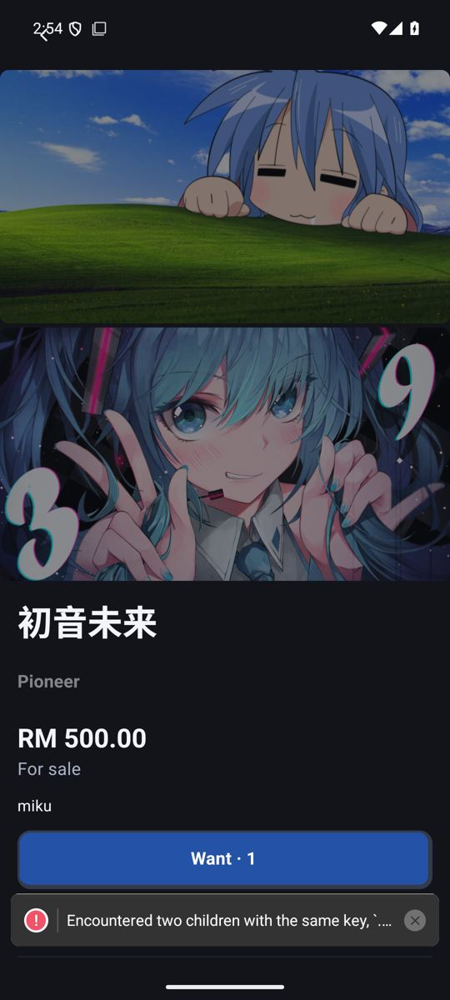 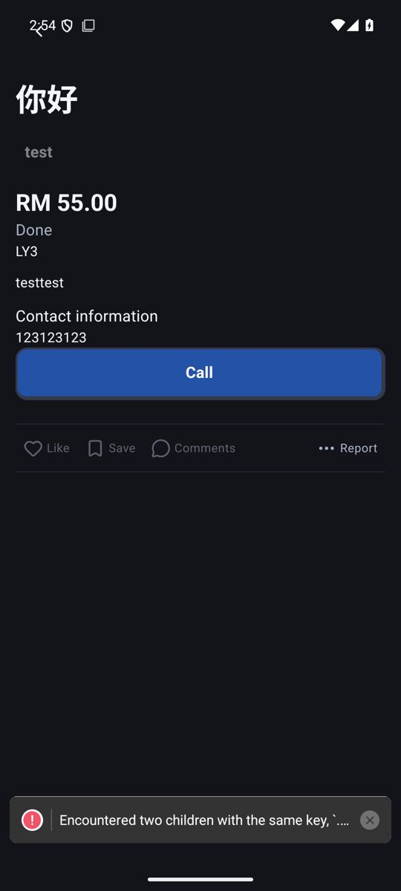 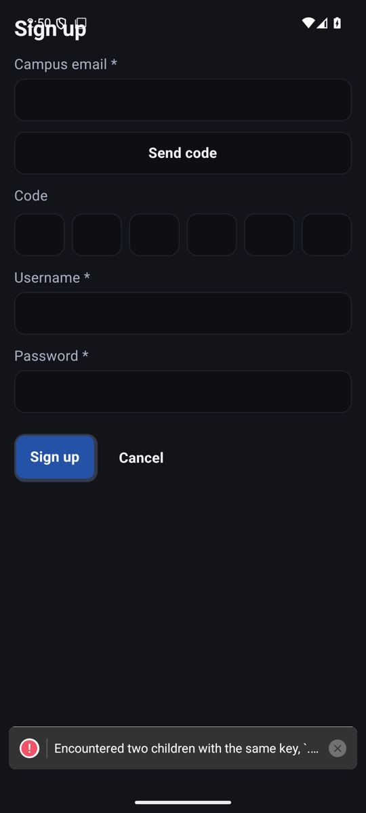

### R4-05 · 跑腿详情对游客公开联系电话；已完成的任务仍显示「Call」（P0 · —）

**现状**
- 未登录即可在跑腿详情看到「Contact information 123123123」和拨号按钮。
- 状态为「Done」的任务仍然给出「Call」主按钮。

**期望**
- 联系方式只对「发布者 / 接单者」可见；其他人看到「接单后可见」。
- 主按钮跟随状态：Open→接单，Taken→联系（仅双方），Done→无主按钮/评价。
- 后端接口同步收紧（不只是前端隐藏）。

**验收**
- 游客与非当事人拿不到联系方式（接口层验证）
- 三种状态主按钮正确

### R4-06 · 深链与 Tab 跳转错位：/canteen 落到广场 Today；「我的」未登录白屏（P0 · —）

**现状**
- `xmumdorm://canteen` 打开的是广场 Today，而不是食堂。
- 未登录点底栏「我的」先出现整屏灰白再跳登录页。
- `smoke` 偶发「点我的后 App 不在前台」。

**期望**
- 每个可分享的路由深链直达对应内容。
- 「我的」游客态给一个可用的游客页（登录入口 + 设置 + 关于），不闪白。

**验收**
- 路由表里每个一级/二级路由深链都落在正确页面（写成自动化用例）

### R4-07 · 登录墙重设计：先让人逛，再在需要时登录，并回到原处（P0 · —）

**现状**
- 点菜品详情、发布、校园助手、设置——全都直接跳整页登录页，不说为什么。
- 登录成功后不回到原来要去的页面（代码里没有 returnTo）。
- 登录页 40% 屏是插画，输入框挤在下半屏，没有说明 App 能做什么。

**期望**
- 浏览类内容（菜品、二手、跑腿、指南、帖子详情）游客可看；只有写操作才要登录。
- 需要登录时弹底部 Sheet：「登录后可以___」+ 登录/注册，成功后自动回到原页面并继续刚才的动作。
- 设置（语言、主题）游客可用。

**验收**
- 游客能打开所有详情页
- 从任意写操作触发登录，成功后回到原页面
- 登录页首屏能看到输入框和一句产品价值

### R4-08 · 注册页重做：品牌、步骤感、校验即时反馈（P1 · —）

**现状**
- 表单堆叠，无品牌元素；「Sign up」主按钮与「Cancel」样式不对等；验证码 6 格无倒计时/重发提示；密码无规则说明。

**期望**
- 分两步：① 校园邮箱 + 验证码（倒计时、重发、自动粘贴）② 用户名 + 密码（规则实时校验）。
- 与登录页统一视觉。

**验收**
- 任一字段出错有「可感知/可理解/可改正」三要素提示

### R4-09 · 首次启动引导：3 屏讲清「课表 / Moodle / 签到」并完成关键授权（P1 · —）

**现状**
- 首启直接进广场，看到的是红锁；用户不知道这个 App 最有用的是什么。

**期望**
- 3 屏以内：今日时间轴是什么 → 连一次校方系统（需校园网）→ 上课提醒（此时才请求通知权限）。可跳过。

**验收**
- 首启 30 秒内能看到「今天的课」或明确的下一步

### R4-10 · 全局视觉基线重做：层级、间距、卡片、分割线（当前"毫无吸引力"的根因）（P1 · —）

**现状**
- 每个区块都是「粗体大标题 + 1px 横线」，首屏视觉噪音高、没有焦点。
- 卡片、列表行、按钮三套圆角/边框语言并存；大面积纯黑底 + 细灰字，层次全靠字号。
- 同一页里蓝色实心按钮过多（Open / Sign in / Call / Want），主次不分。

**期望**
- 按宪法「苹果的舒适感 + Discord 的社区感 + 一点 Neo-Brutalism」出一份可执行的视觉基线：表面层级（canvas / surface / raised 三层）、8pt 间距栅格、卡片规范、一个页面最多一个实心主按钮。
- 分组靠间距和表面色，不靠横线；Neo-Brutalism 粗线只留给 CTA / Badge / 分区标题。
- 先做 3 个样板页（广场 Today、二手列表、菜品详情）经所有者确认，再推全站。

**验收**
- 样板页所有者确认
- 设计债报告 `design-debt-report.js` 数值下降

 

### R4-11 · 交互反馈缺失：没有触感、几乎没有动效、按下无反应（P1 · —）

**现状**
- 全仓 0 处 haptics；reanimated 只在 1 个文件里用；点赞、收藏、切 Tab、发布成功都没有反馈动画。

**期望**
- 引入 `expo-haptics`（先走依赖准入）：点赞/收藏/切 Tab/下拉刷新到位/发布成功给轻触感。
- 统一按压态（缩放 0.97 + 透明度）、点赞心跳动画、列表首屏渐入、页面共享元素转场（列表图 → 详情大图）。
- 尊重系统「减少动态效果」设置。

**验收**
- 以上 5 类交互在真机上有反馈
- 减少动态效果开启时动画降级

### R4-12 · 加载 / 刷新 / 空态统一：全站只有 3 处下拉刷新、3 处骨架屏（P1 · —）

**现状**
- `PullToRefresh` 只被 3 个页面用；骨架屏只有 3 个；多数页面加载时空白，再"啪"地出现。
- 列表底部「No more items / End / No more tasks / All clubs shown」四种说法。

**期望**
- 所有信息流和列表：下拉刷新 + 骨架屏 + 上拉加载 + 统一的到底提示。
- 空态带插画和下一步动作（如「还没有二手，去发第一件」）。

**验收**
- 列表类页面 100% 有下拉刷新与骨架屏（加一条源码扫描测试）

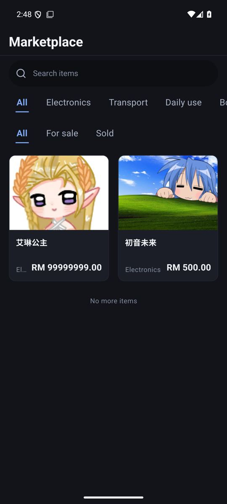 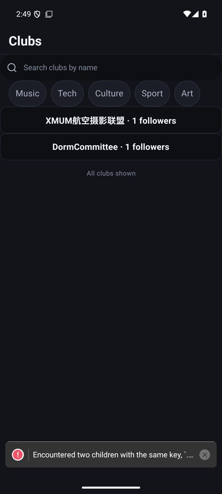

### R4-13 · 二级 Tab 统一成可横滑的下划线 Tab，去掉圆角胶囊按钮（P1 · —）

**现状**
- 二手（两行）、跑腿（两行）、指南、待办、社团各用各的：有的是下划线 Tab，有的是圆角胶囊（社团、待办），所有者已明确不要胶囊。
- 指南页第一个 Tab 左边被裁出半个字母「l」。

**期望**
- 一个 `SecondaryTabs` 组件：横向可滑、选中态为粗下划线（颜色按所有者意见/令牌定）、溢出自动滚到选中项。
- 两行筛选（类别 + 状态）时第二行用更轻的样式，避免两行一样重。

**验收**
- 上述 5 处全部换成同一组件
- 无裁切

 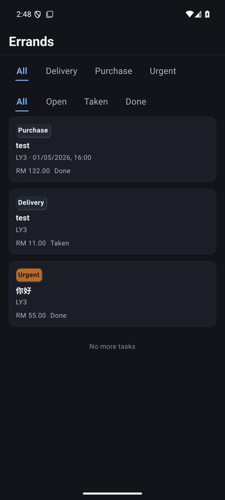   

### R4-14 · 长列表性能：28 个页面用 ScrollView，FlashList 已装却只用在 4 处（P2 · —）

**现状**
- 信息流类页面用 ScrollView + map，数据多了会卡、内存高。

**期望**
- 信息流、二手、跑腿、树洞、点评列表改用 `@shopify/flash-list`。

**验收**
- 200 条数据滚动不掉帧（Android 13 AVD 上测）

### R4-15 · 文案与多语言：截断、单复数、中英混排（P1 · —）

**现状**
- 广场四宫格「Campus g…」「Marketpla…」被截断。
- 「1 followers」单复数错误。
- 菜品英文名 + 店名中文混排；同屏中英两种语言。
- 工具页「School systems」顶部一段说明性长文案（违反宪法 10.5）。

**期望**
- 英文出一份短词表（Guide / Market / Clubs…），按钮/标签 ≤6 汉字或 ≤12 字母。
- ICU 复数。
- 默认跟随系统语言；菜品/店名按当前语言优先显示、另一语言作副标题。
- 删除说明性长文案。

**验收**
- 中英两种语言下一级页面无截断

  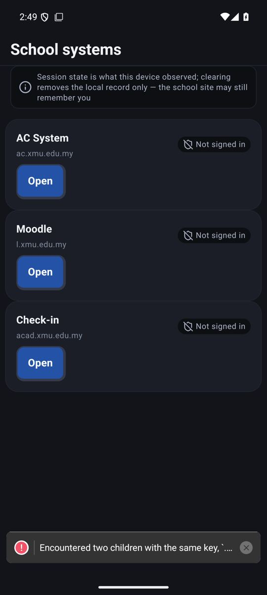

### R4-16 · 生产环境测试数据清理与内容门槛（P1 · —）

**现状**
- 线上可见：跑腿「test / testtest」、二手「RM 99999999.00」、指南「TEST / test」、跑腿联系方式「123123123」。第一次打开的用户看到的就是这些。

**期望**
- 清理现网测试数据（走迁移/后台，⛔ 不手改库）。
- 发布侧加最低门槛：价格上限、标题长度、敏感词；管理端可一键下架。
- 测试改用隔离库（见 R4-33）。

**验收**
- 现网列表无明显测试数据

  

### R4-17 · 广场首页重构：头部占了 40% 屏且不折叠，内容区太小（P0 · —）

**现状**
- Logo 标题 + 4 个大图标 + 校园助手条 + 5 个 Tab，滚动时全部不收起，内容只剩一半屏。
- 四宫格蓝黄交替没有信息含义；黄色到处用，失去「有新东西」的意义。

**期望**
- 大标题随滚动收起成紧凑顶栏；宫格改成一行小入口或并进 Tab。
- 黄色只留给角标/新内容；宫格统一一种填充。
- 校园助手并入顶栏图标或今日时间轴末尾。

**验收**
- 滚动后内容区 ≥80% 屏
- 所有者确认新首屏

 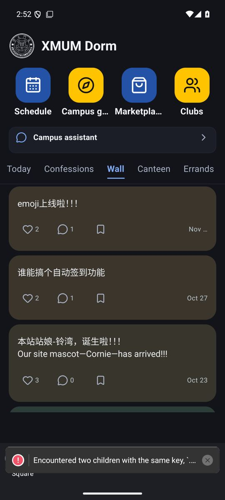

### R4-18 · 「今日」改成时间轴：下一节课 + Moodle 截止 + 按时出现的签到入口 + 待办（P0 · —）

**现状**
- Today 只有「Today classes」和「Moodle due」两个孤立区块，游客全是红锁。

**期望**
- 一条按时间排序的时间轴：进行中的课（高亮）、下一节课、今晚截止的作业、今日待办。
- 课程开始前后 15 分钟在课程卡上出现「签到」按钮直达签到系统（⛔ 不自动签到）。
- 课表与 Moodle 快照存本地，未登录 App 账号也能看。

**验收**
- 有课表时首屏 1 秒内显示下一节课
- 签到入口只在时间窗内出现

### R4-19 · 树洞：标签筛选别用下拉框；卡片层次与互动区（P1 · —）

**现状**
- 「Filter by tag」是一个整行下拉选择框，选一次要点三下。
- 卡片标题和正文重复（同一句话显示两遍）。

**期望**
- 标签做成横滑标签条（热门在前）。
- 标题与正文相同时只显示一次；互动区（评论/赞）对齐、可点区域足够大。

**验收**
- 切换标签 1 次点击完成

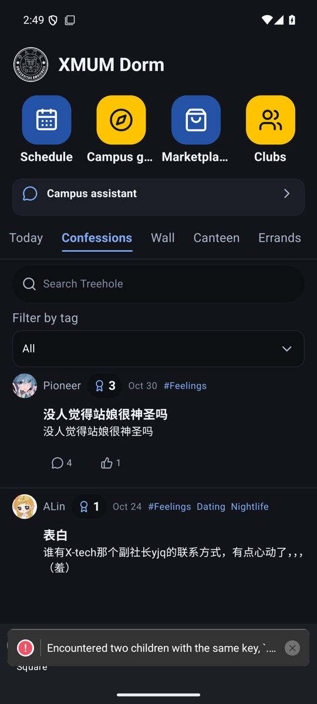

### R4-20 · 万能墙：卡片底色与暗色主题冲突、日期被截断（P2 · —）

**现状**
- 卡片是棕/橄榄色底，放在近黑背景上显脏；日期「Nov …」被截断。

**期望**
- 墙卡片颜色走令牌（暗色有对应档）；日期用相对时间（3 天前）。

**验收**
- 对比度通过 `contrast-check.js`

### R4-21 · 食堂 Tab：排行榜没有区分度、区域入口缺失、「今天吃什么」没有仪式感（P1 · —）

**现状**
- 排行榜分数全是「10」，看不出好坏；只有一个「Menu」Tab。
- 没有 5 个区域入口（所有者三期目标已提）。
- 「Pick for me」只是一个描边按钮；下面的美食帖只有 1 条。
- 菜名被截断（Fish-Flavored Shredded Pork wi…）。

**期望**
- 排行榜按类别下拉切换（不堆叠），展示评分 + 评价数，点条目进菜品详情。
- 区域入口（带图）。
- 「今天吃什么」做成抽奖动效（转盘/卡片翻转 + 触感）。
- 菜名两行显示。

**验收**
- 与 `docs/app/task/Dormapp第三期治理目标.md` §6 对齐并经所有者确认

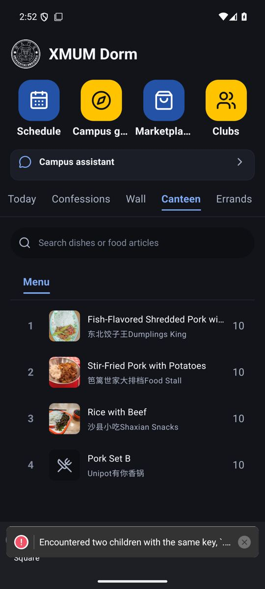 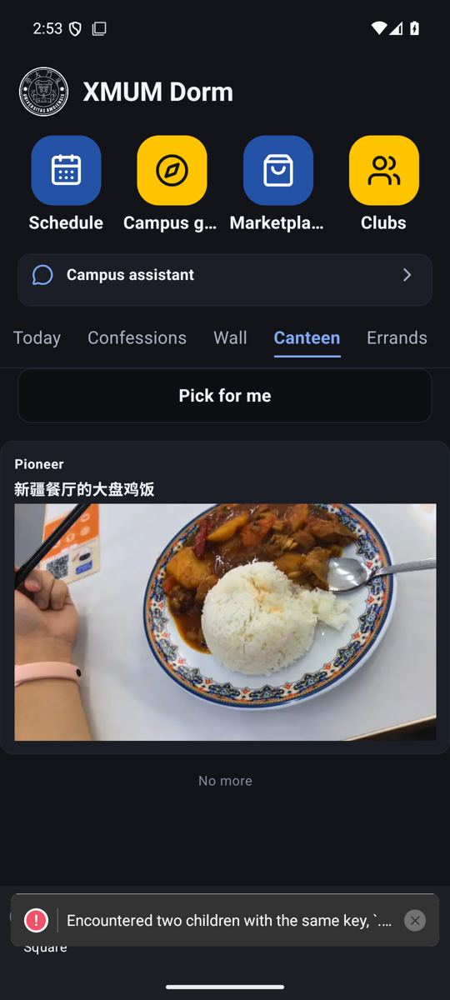

### R4-22 · 菜品详情与点评：游客不能看、无二级回复、评级标签太大（P1 · —）

**现状**
- 游客点菜品直接跳登录页。
- 三期目标里要求的二级回复、评级颜色标签、悬浮「写点评」按钮、爱心收藏尚未落地（需登录后复核）。

**期望**
- 游客可看详情与点评；写点评/收藏才要登录。
- 点评二级回复；等级用不同颜色的小标签；正文字号加大。
- 点评发布页：添加图片一个入口；5 个等级一行。

**验收**
- 所有者按三期目标 §6 逐条验收

### R4-23 · 二手详情：没有卖家信息、评论、点赞、举报；图片竖着堆（P1 · —）

**现状**
- 详情只有图片（纵向堆叠两张大图，没有轮播/指示器）、标题、发布者名字、价格、「Want · 1」。
- 没有卖家头像/信誉、没有评论和举报（所有者三期目标已提）。
- 列表卡片类目被截断成「El…」。

**期望**
- 图片横滑画廊 + 页码 + 点开全屏缩放。
- 卖家卡片（头像、在售件数、注册时间）+ 私信入口。
- 评论、点赞、举报；去掉「保存」。
- 价格筛选左右结构；搜索框置于类别 Tab 上方。

**验收**
- 所有者按三期目标 §7 验收

 

### R4-24 · 跑腿：入口重复、卡片信息层次弱、状态流转不清（P1 · —）

**现状**
- 广场有「Errands」Tab，又有独立跑腿页，两处内容一样。
- 卡片：类型标签 + 标题 + 地点 + 价格 + 状态挤在一起，价格不突出；状态只是一个灰字。

**期望**
- 保留一个入口（广场 Tab），独立页做深链目标。
- 卡片：价格右上大字、截止时间倒计时、状态彩色标签；Urgent 置顶。
- 详情页按状态给主操作（见 R4-05）+ 接单确认 Sheet。

**验收**
- 所有者按三期目标 §8 验收

 

### R4-25 · 新生指南：正文不在 App 里、只有「Open browser」；点赞数显示成「–」（P1 · —）

**现状**
- 指南详情只有一句摘要 + 一个大「Open browser」按钮，正文要跳外部浏览器。
- 评论输入框放在互动栏上面；点赞/评论数显示为「–」。
- 列表全是纯文字行，没有封面。

**期望**
- 正文在 App 内原生渲染（Markdown/富文本），外链降级为「原文」小链接。
- 封面图 + 分类 Tab；点赞、评论、收藏（所有者三期目标 §9）。
- 评论框固定在底部。

**验收**
- 打开任一指南无需离开 App 即可读完

 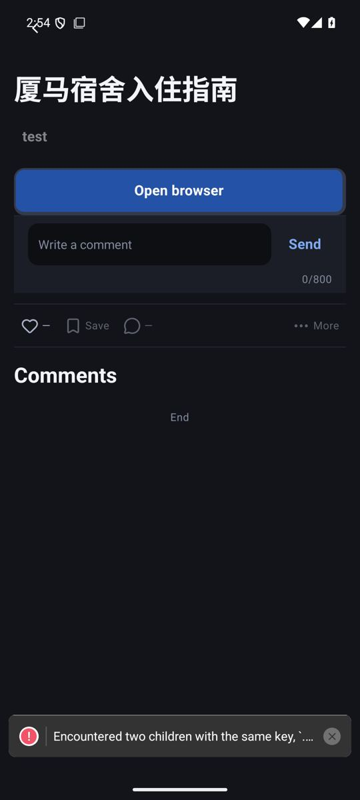

### R4-26 · 社团列表只有名字和关注数，没有吸引力（P2 · —）

**现状**
- 列表行只有「社团名 · 1 followers」居中粗体，无 logo、简介、近期活动；分类是胶囊按钮。

**期望**
- 社团卡片：logo、一句话简介、成员数、最近活动时间；「近期活动」横滑区置顶。
- 分类改为 R4-13 的统一 Tab。

**验收**
- 所有者确认

### R4-27 · 工具页重排：校方系统入口被挤到折叠线下（P0 · —）

**现状**
- 工具页首屏两个红锁错误态，真正的主功能（AC / Moodle / 签到）要滚很远才看到；「School systems」子页三个大「Open」按钮 + 一段长说明。

**期望**
- 首屏：三个校方系统卡片（状态点：已登录 / 未登录 / 已过期 + 「需校园网」提示）→ 今日课表摘要 → 放假日 → 待办 3 条。
- 删除说明性长文案。

**验收**
- 首屏可见三个校方系统入口

 

### R4-28 · 课程表：周数横滑、同课同色、去周末、提醒权限时机（P1 · —）

**现状**
- 进课表页立刻弹系统通知授权，没有任何上下文。
- 三期目标 §2 的周数横滑、不同课程不同颜色、不显示周六日、今日已结束课程撤下等需逐条复核。

**期望**
- 首次导入课表成功后再问「上课前 30 分钟提醒你？」，同意后才调系统授权。
- 按三期目标 §2 逐条落地。

**验收**
- 所有者按三期目标 §2 验收

### R4-29 · 待办：游客也能看到「Add todo」、优先级 High/Medium/Low/Normal 语义重叠（P1 · —）

**现状**
- 未登录时仍显示大号「Add todo」，点了才发现要登录。
- 筛选有 High / Medium / Low / Normal 四档，Normal 和 Medium 区别不明。

**期望**
- 待办本地优先：游客也能建，登录后同步。
- 优先级收敛为 3 档（高 / 中 / 低）或改成「重要」开关。
- 工具页只显示 3 条，其余进二级页（三期目标 §3）。

**验收**
- 游客能新建待办

### R4-30 · 校方系统 WebView 剩余问题：签到每次重登、新窗口丢会话、AC 桌面页、校园网提示（P1 · —）

**现状**
- 见 `docs/app/evaluation/校方系统WebView评估与UIUX改进方向.md` W-3…W-9：签到 token 存 sessionStorage（关页即丢）、`window.open` 跳系统浏览器丢会话、AC 无 viewport、密码框 autocomplete=off、无「需校园网」提示。

**期望**
- 所有者账号在场实测会话持久性后，决定签到 WebView 常驻方案。
- 接 `onOpenWindow`：同源在当前 WebView 打开。
- AC 允许缩放；打开前提示校园网。

**验收**
- 同一次 App 运行内重复打开签到不需重新登录

### R4-31 · 消息 / 信箱：按钮主次、点击跳转到对应内容（需登录复核）（P1 · —）

**现状**
- 本轮无测试账号，未能进入登录态复核。三期目标 §信箱 的三条（「全部已读/清空」缩小、点通知跳到对应帖子/交易、作为底部 Tab）需逐条确认现状。

**期望**
- 按三期目标逐条落地；通知按「互动 / 交易 / 系统」分组，未读角标与「我的」私信联动。

**验收**
- 所有者用真实账号逐条验收

### R4-32 · 「我的」与发布中心：游客态可用、发布流程体验（需登录复核）（P1 · —）

**现状**
- 游客点「我的」白屏后跳登录；点「＋」直接跳登录，看不到能发什么。
- 发布表单、草稿、图片上传体验本轮未能复核。

**期望**
- 游客「我的」：登录卡片 + 设置 + 关于 + 法务。
- 发布中心游客可看「能发什么」，选中后再要求登录；发布表单统一：草稿自动保存、图片多选排序、发布成功动效 + 跳到刚发的内容。

**验收**
- 所有者用真实账号走一遍 5 类发布

### R4-33 · 治理前置：专用测试账号 + 隔离预览库，让 agent 能自测登录态页面（P0 · —）

**现状**
- `app/.preview/test-account.json` 不存在；本机 MySQL 凭据错误导致隔离库模式起不来。本轮审计因此只覆盖了游客可见页面，消息/我的/发布/点评/待办等登录态页面全部无法自测。

**期望**
- 所有者提供一个专用生产测试账号（⛔ 不用真人账号），或修好本机 MySQL 让 `devicectl backend init/db/seed` 跑通。
- `devicectl smoke` 增加登录态巡检。

**验收**
- `devicectl login` 成功，smoke 覆盖登录态五个 Tab

## 5. 建议顺序

1. **R4-33** 测试账号 / 隔离库（否则登录态页面无法自测）
2. **P0 缺陷**：R4-01 → 02 → 03 → 04 → 05 → 06（都小，一周内可清）
3. **第一印象**：R4-07 登录墙 → R4-17 广场首页 → R4-18 今日时间轴 → R4-27 工具页
4. **视觉基线 R4-10**：先 3 个样板页给所有者确认，再与 R4-11/12/13 一起推全站
5. 各模块 P1，最后 P2
